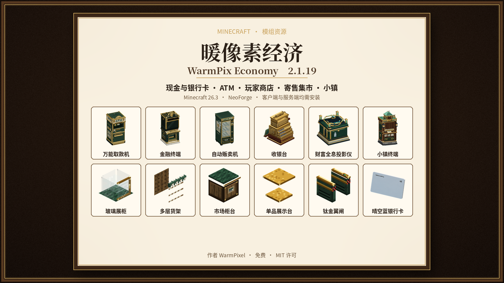
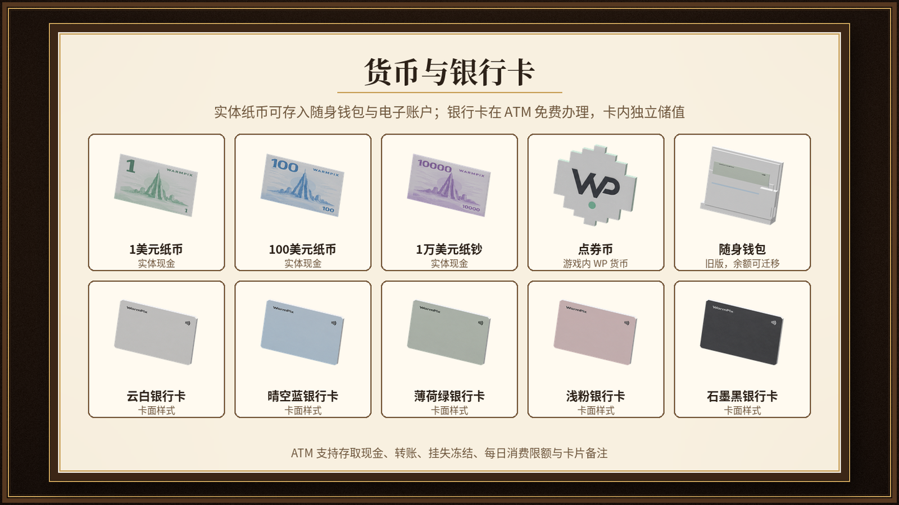
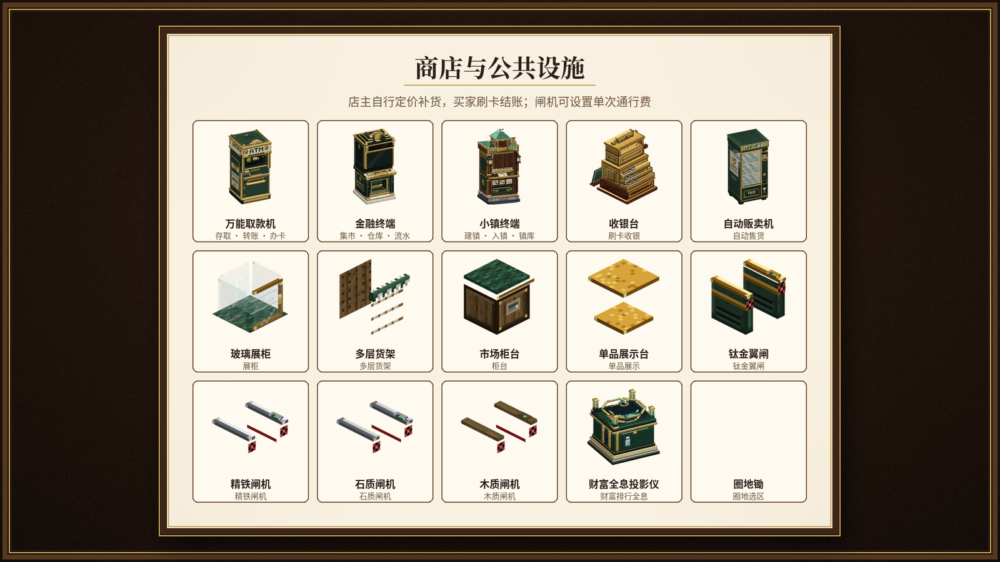
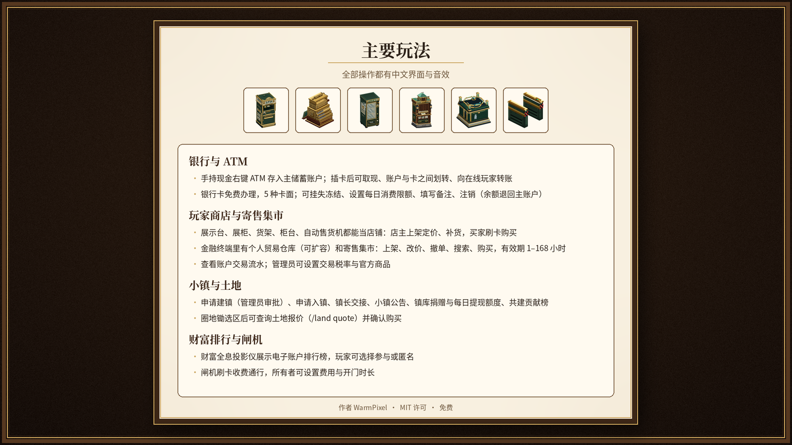

# 暖像素经济 WarmPix Economy

一套完整的服务器经济：实体现金与银行卡、ATM、玩家商店、寄售集市、小镇镇库与土地购买。

- Minecraft：26.3
- 加载器：NeoForge 26.3.0.23-beta 或更高
- 客户端与服务端都需要安装
- 无其他模组前置
- 语言：简体中文 / English

## 截图 Screenshots

## 下载

请到 [Releases](../../releases) 页面下载 jar（版本 2.1.19）。

## 内容

- 实体纸币（1 美元、100 美元、1 万美元）与 WP 货币，可存入电子账户
- 银行卡在 ATM 免费办理，5 种卡面，卡内独立储值；ATM 可存取现金、划转、向在线玩家转账、挂失冻结、设置每日消费限额与备注
- 展示台、玻璃展柜、多层货架、市场柜台、自动售货机、收银台：店主上架定价补货，买家刷卡购买
- 金融终端：个人贸易仓库（可扩容）、寄售集市（上架、改价、撤单、搜索、购买，有效期 1–168 小时）、交易流水
- 小镇终端：申请建镇（管理员审批）、入镇、镇长交接、公告、镇库捐赠与每日提现额度、共建贡献榜
- 圈地锄选区后查询土地报价并确认购买（/land quote、/land confirm）
- 财富全息投影仪：电子账户排行榜，玩家可选择参与或匿名
- 闸机（钛金、精铁、石质、木质）：刷卡收费通行，所有者可设置费用与开门时长
- 管理员可设置交易税率、官方商品、无限库存，以及余额调整等管理指令

## 说明

- 本仓库只用于发布 jar，不含源码。
- jar 约 36 MB，主要是高清方块贴图。
- 货币均为游戏内虚拟货币，本模组不含任何现实支付功能。

作者：WarmPixel（LICENSE 署名 WarmPixel Studio） ｜ 许可：MIT

## 🏡 暖像素 WarmPix 服务器

本模组正在 **暖像素 WarmPix** 服务器上使用，欢迎来服里实际体验。

暖像素 WarmPix 是新开的 Java 26.3 NeoForge 模组生存服，公益服无付费内容，多线、无白名单，正版/离线账号都能进。新服招人开荒，长期稳定运营、永久不跑路。

- 服务器地址：`minecraft.warmpix.com`
- 官网：https://warmpix.com/
- 宣传片：https://www.bilibili.com/video/BV1NhWh6dEcu/
- QQ 群：**705556278**

扫码或搜索群号 705556278 加入 QQ 群。
